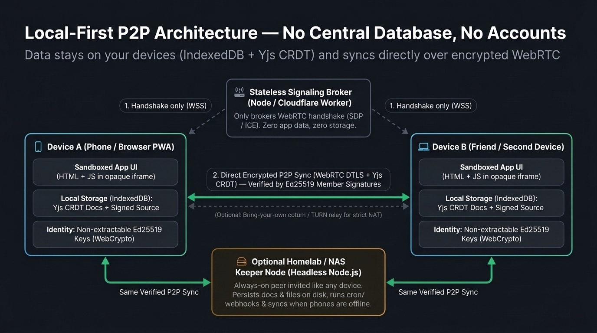
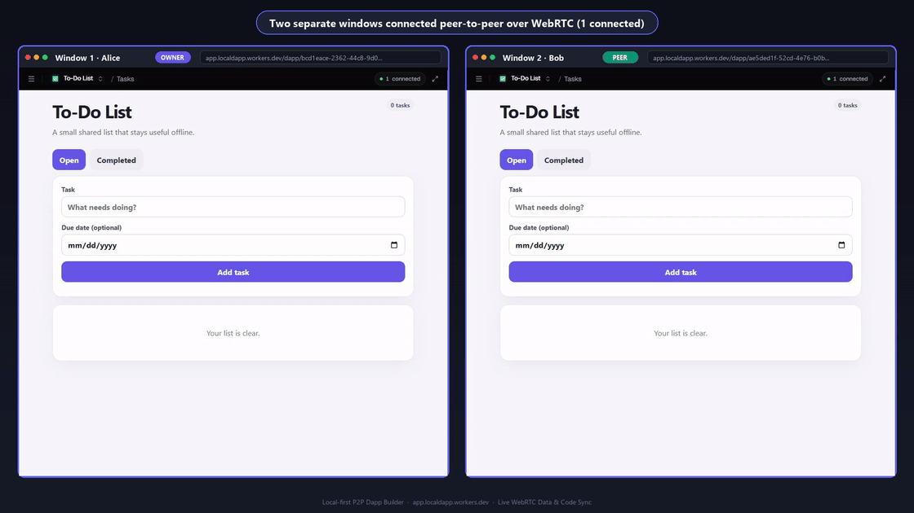
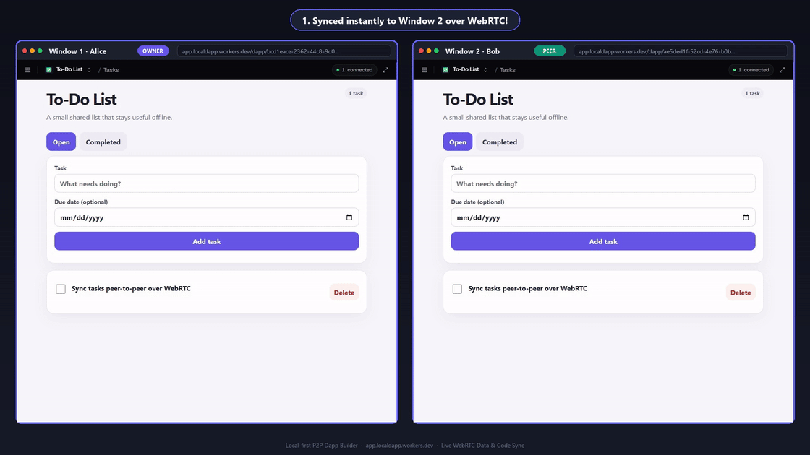
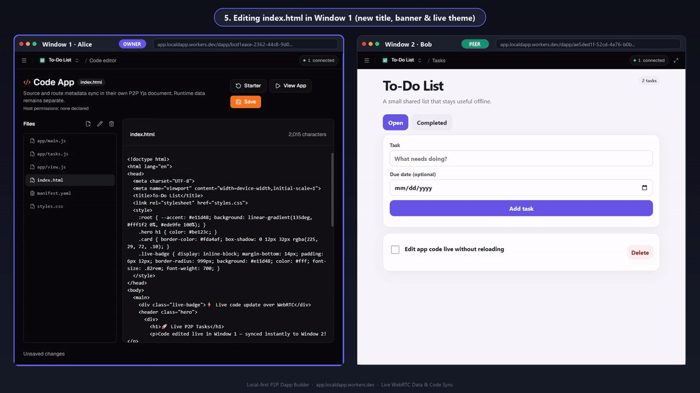

# Dapp Builder



> **Temporary demo notice:** `https://app.localdapp.workers.dev` is hosted only to showcase this beta and collect feedback — **it may go offline or disappear at any time**. Because browser storage is tied to the origin, do not store anything important only on the demo URL; self-host your own instance for real use.

A local-first, peer-to-peer app builder. Apps ("dapps") are small HTML Code Apps whose
data lives in Yjs documents on the members' own devices and syncs directly between them
over WebRTC. There is no account and no central data store: servers only introduce
devices to each other (signaling) and, optionally, relay push notifications.

- Live demo: https://app.localdapp.workers.dev *(temporary beta preview for showing the app and gathering feedback — it could disappear at any time without notice; self-host for real use)*
- How it works: `public/how-it-works.html`, building Code Apps: `docs/code-apps/README.md`
- Security model and known residual risks: `docs/security/THREAT_MODEL.md`
- Self-hosting (static site, signaling broker, keeper node, push relay, €0 Cloudflare):
  `docs/DEPLOYMENT.md`, `docs/CLOUDFLARE.md`, `docs/HEADLESS.md`, `docs/PUSH-RELAY.md`

## Live P2P Sync Demo

Two separate browser sessions (**Window 1 · Owner** and **Window 2 · Peer**) running the same Code App connected directly over WebRTC — no backend database, no page reloads.

### 1. Live P2P data sync (Window 1 → Window 2)

A task added in Window 1 is Ed25519-signed and synced immediately to Window 2 over the member-verified WebRTC mesh.



### 2. Bidirectional edits & task completion (Window 2 ↔ Window 1)

Window 2 adds a second task that appears immediately in Window 1; checking off a task in Window 1 updates both windows live.



### 3. Edit the app's own source code in the browser

Window 1 opens the built-in **Code editor** and updates `index.html` (new heading, banner, and CSS theme) while Window 2 keeps running the live app.


### 4. Instant live code sync — zero refresh, data intact

Clicking **Save** in Window 1 seals the updated source with the owner's key and pushes it to the isolated Yjs source document. Window 2 re-renders immediately with the new UI while keeping all synced task data intact.



## Development

Node 22 or newer.

```sh
npm install
npm run dev        # Vite + local signaling broker
npm test           # Vitest
npm run typecheck && npm run lint && npm run build
```

`CLAUDE.md` describes the architecture in detail.

## License

MIT, see `LICENSE`. The software comes without warranty. Your apps, data and keys live on
your devices and are your responsibility; see the terms of use (`public/terms.html`).
